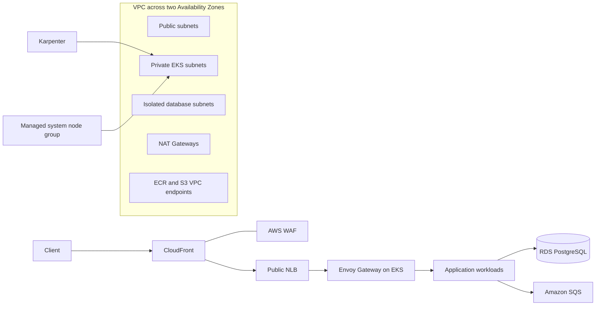

# Nexus Infrastructure

Terraform repository for the AWS foundation of the Nexus platform. It owns
bootstrap resources, cross-environment shared resources, and isolated
development and production stacks in `ap-southeast-1`.

The configuration currently targets AWS account `863547508328` and the
`tin-nexus.com` domain. Account IDs, administrator principals, state backends,
DNS, certificates, and IAM trust conditions must be reviewed before reuse in a
different account.

## Architecture



CloudFront and WAF form the public edge. The distribution forwards to an NLB,
which targets Envoy Gateway through AWS Load Balancer Controller resources
managed in `nexus-gitops`.

## Ownership Boundary

Terraform owns:

- VPCs, subnets, routes, NAT gateways, security groups, and VPC endpoints
- EKS control planes, managed system nodes, add-ons, and access entries
- Karpenter IAM, interruption resources, Helm bootstrap, and node classes
- IAM and IRSA roles for workloads and platform controllers
- KMS keys for Vault auto-unseal, RDS, and ECR
- RDS PostgreSQL, SQS queues, and dead-letter queues
- immutable ECR repositories
- ACM certificates, CloudFront distributions, WAF, NLBs, and Cloudflare DNS
- GitHub Actions OIDC and Terraform/release roles

Argo CD, Vault workloads, ESO, Envoy Gateway, policies, observability, and
application workloads are Kubernetes desired state owned by `nexus-gitops`.

## Terraform Roots

```text
bootstrap/
  backend/          Versioned and encrypted S3 Terraform state bucket
  github-oidc/      GitHub OIDC provider and Terraform CI/plan roles
shared/             ECR, ECR KMS, ACM, and application release IAM
envs/
  dev/              Development AWS and EKS environment
  prod/             Production AWS and EKS environment
modules/            Reusable infrastructure modules
docs/               Operational protocols, including cost measurement
```

Each root has an independent state key. Apply roots in dependency order:

```text
bootstrap/backend
  -> bootstrap/github-oidc
  -> shared
  -> envs/dev or envs/prod
  -> Argo CD bootstrap from nexus-gitops
```

The backend bucket has `prevent_destroy`; removing an environment does not
remove Terraform state history.

## Modules

| Module | Responsibility |
| --- | --- |
| `network` | VPC, multi-AZ subnets, routing, NAT, security groups, ECR/S3 endpoints |
| `eks` | EKS control plane, managed system node group, add-ons, and OIDC |
| `karpenter` | Controller bootstrap, interruption queue, NodePool, and EC2NodeClass |
| `iam` | Controller and workload IRSA roles, including Vault and monitoring agent |
| `kms` | Customer-managed keys and aliases |
| `ecr` | KMS-encrypted immutable image repositories |
| `rds` | PostgreSQL, subnet/parameter groups, logging, and AWS-managed master credential |
| `sqs` | User event queue and dead-letter queue |
| `nlb` | Public NLB and Envoy target group |
| `cloudfront` | Public API distribution |
| `waf` | CloudFront Web ACL and managed protections |
| `acm` | Cloudflare DNS-validated public certificate |

## Environment Differences

Both environments use two Availability Zones, private EKS nodes, isolated RDS
subnets, a small on-demand system node group, and Karpenter application
capacity. Development favors fast iteration and lower retention. Production has
a separate VPC CIDR, narrower configurable API access, longer backup/log
retention, and a larger Karpenter ceiling.

Environment-specific values currently live directly in each root. Treat
production as a separate apply decision; the default CI workflow applies only
`shared` and `envs/dev`.

## Prerequisites

- Terraform 1.7 or newer
- AWS CLI authenticated to the intended account
- kubectl, Helm, and AWS IAM permissions for EKS-backed providers
- a Cloudflare API token with zone-read and DNS-edit permissions
- access to the configured S3 state backend

Before every plan or apply:

```bash
aws sts get-caller-identity
terraform fmt -check -recursive
```

## Local Validation

From the repository root:

```bash
terraform fmt -check -recursive
tflint --init
tflint --recursive
trivy config .
```

Validate or plan one root at a time:

```bash
terraform -chdir=shared init
terraform -chdir=shared validate
terraform -chdir=shared plan
```

Repeat with `envs/dev` or `envs/prod` only after the preceding roots exist.
A plan can contact AWS, Cloudflare, and the Kubernetes API but must not change
infrastructure.

## Applying Infrastructure

An apply creates billable resources. Review the saved plan and account identity
before execution:

```bash
terraform -chdir=shared plan -out=tfplan
terraform -chdir=shared apply tfplan
```

Apply the selected environment separately after shared resources are ready.
The EKS root uses Kubernetes and Helm providers for Karpenter bootstrap, so the
executing principal must be able to obtain a valid EKS token.

Do not target individual resources for ordinary changes. Targeted apply is used
by CI only to establish the Terraform CI EKS access entry before the complete
development apply.

## CI Behavior

Pull requests to `main` run:

- Terraform formatting and TFLint
- Checkov
- Trivy IaC scanning
- read-only plans for `shared` and `envs/dev`
- a summarized plan comment plus complete plan artifacts

A push to `main` applies `shared` and then `envs/dev` through the
GitHub OIDC Terraform role. Production is intentionally not auto-applied.

## Destruction and Dependencies

Destroying EKS infrastructure requires coordination with GitOps-managed
resources. Kubernetes-created load balancers, target bindings, Karpenter nodes,
ENIs, and security-group references can block subnet or security-group deletion.
The Helm provider also needs a reachable cluster while removing Karpenter.

For a controlled teardown:

1. stop application delivery and remove GitOps workloads that create AWS
   dependencies;
2. remove Karpenter-provisioned capacity while the cluster is reachable;
3. destroy the environment root;
4. destroy `shared` only when no environment or release pipeline needs it;
5. retain the backend unless state retention is deliberately being retired.

Never manually delete a dependency merely to make Terraform pass without first
identifying its owner.

## Cost Measurement

[`docs/COST_BENCHMARK.md`](docs/COST_BENCHMARK.md) defines the daily snapshot
protocol. The snapshot command makes a Cost Explorer request, records sanitized
resource and cluster evidence outside this repository, and separates
retail-equivalent cost, consumed credits, and payable balance.

## Sensitive Data

Never commit:

- Terraform state or saved plans
- AWS or Cloudflare credentials
- kubeconfigs
- Vault initialization material
- private keys
- local variable files containing secrets

Backend configuration and resource identifiers are not credentials, but changes
to them can redirect or orphan state and require deliberate review.
